<div align="center">



[](https://github.com/sagarkonkanagaon-netizenk/number-passport/actions/workflows/ci.yml)
[](LICENSE)
[](pyproject.toml)
[](docs/faq.md#which-regulations-does-it-help-with)
[](#use-it-from-an-ai-assistant)

[How it works](docs/how-it-works.md) · [Quick start](#try-it-in-two-minutes) · [Configuration](docs/configuration.md) · [Security](docs/security.md) · [Architecture](docs/architecture.md) · [FAQ](docs/faq.md)

</div>

---

A regulator asks: *"Where does the 1,088,769,797.07 of risk-weighted assets on page 4 come from?"* Today a
team spends days reading SQL, dbt models and Spark jobs and running ad-hoc queries. Number Passport answers
in under a minute:

```text
$ passport trace total_rwa
Total risk-weighted assets (USD): GAPS FOUND
  hop  0 gap          report: Total risk-weighted assets (USD)       1088769797.07  unexplained 3100000.00
           ! CRITICAL: the report shows 1,088,769,797.07 but gold.rwa_by_class totals 1,085,669,797.07
             (difference 3,100,000.00): a manual adjustment or a report built from another source
  hop  1 reconciled   gold.rwa_by_class        SUM(rwa_usd)          1085669797.07
           - inner join ref.risk_weights AS rw            0 rows            0.00  models/dbt/gold/rwa_by_class.sql:19
  hop  2 reconciled   silver.exposures         SUM(ead_usd)          2365768570.80
           - dedup ROW_NUMBER() OVER (PARTITION BY ...)   30 rows   -34697141.71  models/sql/silver_exposures.sql:8
           - inner join bronze.fx_rates AS fx            15 rows            0.00  models/sql/silver_exposures.sql:18
           - filter l.status <> 'CLOSED'                120 rows  -153180711.57  models/sql/silver_exposures.sql:20
           - filter l.amount > 0                          8 rows     6999452.32  models/sql/silver_exposures.sql:21
  hop  3 reconciled   silver.collateral_adj    SUM(collateral_usd)    238633695.10
           - filter (haircut < 1)                         6 rows            0.00  jobs/collateral_adjust.py:14
  hop  5 source       bronze.loans             SUM(amount)          49965607732.58
  ...
51 read-only queries · evidence pack: passports/total_rwa-20261103T101500Z
```

It found the 3.1M manual adjustment that is in the report but not in the warehouse, and it says, to the
cent and to the line of code, what every filter, join and dedup did on the way.

## What it does

For one number, Number Passport:

1. **Builds the lineage from code, not from names.** It parses SQL (`CREATE TABLE AS`, `INSERT`), dbt models
   (source files or `manifest.json`), PySpark jobs (translated step by step to SQL) and Airflow DAGs (to tag
   each model with its DAG and task). Column-level lineage follows the measure through every hop.
2. **Reconciles every hop.** For each table on the path it compares:
   - the value the table holds now;
   - the value its code would produce if re-run now (a mismatch is flagged as `table_code_mismatch`);
   - the effect of each row-removing step (WHERE conditions, inner joins, `QUALIFY`/dedup, `DISTINCT`,
     `HAVING`), measured by turning all of them off and back on one at a time, so the step effects add up
     exactly to the difference between input and output;
   - rows lost to inner joins, with their value in the source currency;
   - join fan-out (duplicate join keys that silently multiply money).
3. **Checks data quality** on each table: row counts, NULL measures, duplicate keys (from config or inferred
   from the dedup in the code) and freshness against the report's as-of time.
4. **Compares the report itself** (a CSV cell) with the warehouse, and flags any difference as a CRITICAL gap.
5. **Writes an evidence pack**: `passport.html` (one self-contained page with the lineage diagram, hop
   cards and findings), `passport.json`, `replay.sql` (every query it ran) and `MANIFEST.sha256`.
6. **Re-checks a pack later** with `passport verify`: file integrity, whether any pipeline code changed
   since, and whether every query still returns the same result.

Statuses are strict: `verified`, `gaps_found`, `partially_verified` (some hops could not be checked) and
`lineage_only` (offline). A residual above tolerance is never rounded away.

## Try it in two minutes

```bash
git clone https://github.com/sagarkonkanagaon-netizenk/number-passport
cd number-passport
pip install -e ".[mcp]"
python examples/bank/build.py              # sample bank: bronze -> silver -> gold -> Q3 capital report
cd examples/bank
passport doctor                             # checks every connection point
passport trace total_rwa                    # gaps_found: the 3.1M manual adjustment
passport trace total_ead                    # verified
passport trace corporate_rwa                # verified, with a WHERE filter
passport verify passports/<pack>            # re-check the pack
python build.py --late-data && passport trace total_rwa   # late rows: table_code_mismatch on silver
```

The sample pipeline mixes all four code types: a SQL model with a `QUALIFY` dedup and an FX join, a dbt
gold model, a PySpark collateral job (run by real Spark when `pyspark` and Java are installed) and an Airflow
DAG.

## Connecting to your data: three levels

You never need to give it more than read access, and you can start with no access at all.

| Level | What it needs | What you get |
|-------|---------------|--------------|
| 1. Code only | The pipeline repo | Lineage with file:line, DAG and task, every filter and join (`--offline`, status `lineage_only`). |
| 2. Read-only login | A database role with `SELECT` only | Full reconciliation and quality checks. Only aggregates leave the database. |
| 3. Extracts | CSV or Parquet files, one folder per schema | Full reconciliation with no database connection at all (`files:///path`). |

Supported connection URLs:

```yaml
connection:
  url: duckdb:///warehouse/bank.duckdb      # opened read_only
  url: files:///exports                      # exports/<schema>/<table>.csv|parquet
  url: postgresql://reader@db/risk           # pip install "number-passport[postgres]"; session forced READ ONLY
  url: snowflake://...                       # pip install "number-passport[sqlalchemy]" + the driver
```

Use `${PASSPORT_DB_URL:-default}` in `passport.yml` to keep credentials out of the file.

## Commands

| Command | What it does |
|---------|--------------|
| `passport init` | Write a starter `passport.yml`. |
| `passport doctor` | Check config, code paths, parsing, cycles, connection, read-only access, privacy guard, replay of every model in the warehouse dialect, metrics and report cells. |
| `passport metrics` | List configured metrics. |
| `passport lineage <table>` | Code-only lineage for a table. |
| `passport trace <metric>` | Trace and write an evidence pack. Ad hoc: `--table --column --agg --where`. |
| `passport trace ... --strict` | Exit code 2 when gaps are found, for CI gates before a filing. |
| `passport trace ... --json` | Machine-readable digest. |
| `passport verify <pack>` | Re-check a pack (`--offline` for integrity and code drift only). |
| `passport mcp` | Run the MCP server (stdio, or `--http` for streamable HTTP). |

## Use it from an AI assistant

Number Passport ships an MCP server and an agent skill (`skill/SKILL.md`). The skill tells the assistant how
to run the method and how to talk about results honestly; the server does the work.

```bash
claude mcp add number-passport -- passport mcp --project /path/to/project
cp -r skill ~/.claude/skills/number-passport
```

For Claude Desktop, Cursor and other MCP clients:

```json
{
  "mcpServers": {
    "number-passport": {
      "command": "passport",
      "args": ["mcp", "--project", "/path/to/project"],
      "env": { "PASSPORT_DB_URL": "postgresql://reader@db.internal/risk" }
    }
  }
}
```

Tools: `passport_doctor`, `list_metrics`, `show_lineage`, `trace_number`, `verify_passport`. All are
read-only except `trace_number`, which writes the evidence pack to disk.

## Security model

- **Read-only, enforced twice.** Connectors open DuckDB with `read_only=True` and put Postgres sessions in
  `READ ONLY` mode with a rollback after every query. `passport doctor` tries a write and fails if it works.
- **Aggregates only.** Every query passes a privacy guard before it runs: one `SELECT`, aggregate-only
  outputs, no DDL or DML, no table functions or file readers (`read_csv`, `COPY`, `ATTACH`...), at most 50
  result rows. Grouping by a column is only allowed for columns the data owner lists under
  `privacy.safe_dimensions` with `privacy.mode: allow_dimensions`.
- **Every query is logged** with its purpose and a SHA-256 of the result, inside the evidence pack.
- **Nothing is sent anywhere.** The engine has no network calls of its own. When used through MCP, the
  assistant only sees the digest of totals, counts and code locations.
- The HTTP MCP transport has no authentication of its own: run it behind your own authenticating proxy.

The full threat model, guard rules and a reviewer summary are in [docs/security.md](docs/security.md).

## Documentation

| Guide | For |
|-------|-----|
| [How it works](docs/how-it-works.md) | Everyone: the method, a worked example, statuses and every finding code. |
| [Configuration reference](docs/configuration.md) | Data engineers: `passport.yml`, connections, metrics and privacy modes. |
| [Security and privacy model](docs/security.md) | Security, data protection and model risk reviewers. |
| [Architecture](docs/architecture.md) | Contributors: modules, design decisions and how to extend. |
| [FAQ](docs/faq.md) | Comparisons with lineage and data-diff tools, regulations, limits. |

## Configuration

See [`examples/bank/passport.yml`](examples/bank/passport.yml) for a complete, commented example: code paths,
connection, privacy, tolerance, as-of time, per-table keys and freshness limits, and metrics with their report
cell.

## Limitations

- Measures must be additive (`sum` or `count`). Ratios and averages are traced through their numerator and
  denominator metrics.
- dbt Jinja beyond `ref`, `source` and `config` (macros, loops) marks the model `opaque`; use
  `dbt compile` and point `code.dbt.manifest` at `target/manifest.json` to trace compiled SQL.
- The PySpark translator covers the DataFrame API used in ETL (select, filter, withColumn, join, groupBy,
  agg, drop, dedup, renames, `spark.sql` strings). UDFs, RDDs and dynamic code are marked `opaque` with their
  upstream tables, so lineage continues but that hop is not reconciled.
- `dropDuplicates` keeps an arbitrary row in Spark; the translation keeps the first by key and the pack
  notes it.
- Stored procedures and views defined only in the database are not parsed.

## Development

```bash
pip install -e ".[dev]" pyspark
ruff check . && ruff format --check . && mypy src
pytest                                      # Postgres tests run when NP_TEST_POSTGRES_URL is set
```

CI runs lint, types and the full suite on Python 3.10 to 3.13, against a real PostgreSQL service and a real
local Spark.

## Contributing

Contributions are welcome. Please read [CONTRIBUTING.md](CONTRIBUTING.md) and the
[Code of Conduct](CODE_OF_CONDUCT.md). Report security issues privately as described in
[SECURITY.md](SECURITY.md). For help, see [SUPPORT.md](SUPPORT.md). Changes are listed in
[CHANGELOG.md](CHANGELOG.md).

## License

Copyright 2026 Sagar Konkanagaon. Licensed under the [Apache License, Version 2.0](LICENSE); see
[NOTICE](NOTICE). You may use, modify and distribute it, including commercially, under the terms of that
license.
