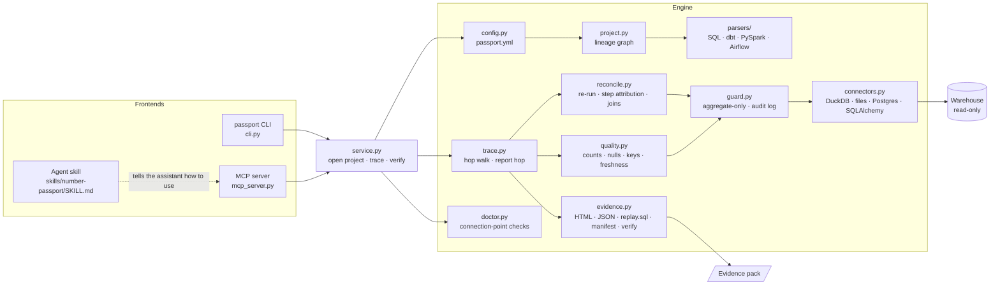

# Architecture

Number Passport is a small Python library with three front ends (CLI, MCP server and agent skill) over one
engine. Everything below `service.py` is pure library code with no global state, so it can also be embedded
in your own tools.

## Modules

| Module | Responsibility |
|--------|----------------|
| `config.py` | Load and validate `passport.yml`, expand `${ENV}` references, resolve paths. |
| `parsers/sql_parser.py` | Turn SQL scripts and stored procedures into `Model`s (target, query, upstream, file and line): statement-by-statement parsing with a fallback splitter, procedure bodies per dialect, temp-table inlining, `MERGE`, and post-load `DELETE`/`UPDATE` folded into the query. |
| `parsers/sas_parser.py` | Translate SAS `PROC SQL`, DATA steps, `PROC SORT`, `PROC MEANS` and `PROC APPEND` into SQL CTEs with a line map back to the `.sas` file. |
| `parsers/informatica_parser.py` | Translate PowerCenter mapping exports (XML) into SQL, one CTE per transformation, following port wiring. |
| `parsers/dbt_parser.py` | dbt sources (Jinja blanked, line numbers kept) or `manifest.json`. |
| `parsers/pyspark_parser.py` | Read PySpark as a Python syntax tree and translate each DataFrame line into a SQL CTE, with a line map back to the Python. |
| `parsers/airflow_parser.py` | Map job files to DAG id, task id and schedule. |
| `project.py` | One lineage graph: upstream, downstream, ancestors, cycles, duplicate producers; adds views defined only in the warehouse. |
| `guard.py` | Check every query before it runs, enforce the row limit, keep the audit log. |
| `connectors.py` | Read-only database access behind one small interface (`query`, `columns`, `schema`, `ping`, `probe_write`). |
| `reconcile.py` | Per-hop analysis: recomputed vs actual, relaxed value, sequential step attribution, rows removed, inner-join loss in native units, fan-out. |
| `quality.py` | Row count, measure NULLs, duplicate keys and freshness for each table. |
| `trace.py` | Walk from the metric to the sources, add the report hop, collect findings and code fingerprints, decide the status. Averages and ratios become a `CompositePassport` over two additive traces. |
| `evidence.py` | Write and verify evidence packs; render the self-contained HTML page. |
| `doctor.py` | Check every connection point before a trace. |
| `service.py` | The small API both front ends call. |

## Design decisions

**Lineage from code, not from a catalogue.** Catalogues describe what someone declared. Regulators ask
what the code did. Reading the code also gives file:line for every step, which is what makes a finding
actionable.

**Re-run, don't sample.** Each hop is checked by re-running the model's own SQL in the warehouse and
aggregating it, so the check covers every row, and no row ever leaves the database.

**Sequential attribution.** Turning steps back on one at a time, in code order, makes the step deltas sum
to the total change, to the cent. Methods that measure each step alone double-count rows that several
steps remove.

**Translate PySpark instead of running it.** Running a job needs a cluster, credentials and side effects.
Translating it to SQL gives the same numbers in the warehouse (the CI suite proves this against real Spark)
and keeps the tool read-only.

**Degrade loudly.** Code that can't be translated becomes an opaque model, never a silent hole. A query
that fails becomes a finding on that hop, and the rest of the trace still runs. The status can never be
`verified` while anything is unexplained.

**Evidence is a file, not a dashboard.** Auditors keep files. The pack is self-contained, hash-sealed and
re-checkable years later with `passport verify`.

## Extending

- **A new warehouse**: subclass `Connector` in `connectors.py` and implement `query`, `columns`, `ping` and
  `probe_write` (and `views` to follow database-only views), with read-only enforced at the session level. Register the URL scheme in `connect()`.
- **A new code language**: write a parser that yields `Model` objects (target, sqlglot query, upstream
  tables, `SourceRef` with file and line, and `line_map` if one model spans several lines). Add it to
  `load_project`.
- **A new check**: add it to `quality.py` or `reconcile.py` as a `Finding` with a stable code, and add it to
  the catalogue in [how-it-works.md](how-it-works.md#10-findings-catalogue).
